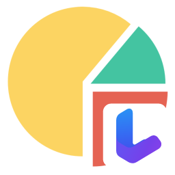

<p align="center">
  
</p>

# Lengko.Chart.Wpf — Demos & Samples

Interactive sample showcase for **Lengko.Chart.Wpf**, featuring high-performance hardware-accelerated WPF charting controls rendered using native `DrawingContext` and `StreamGeometry`.

[]()
[]()
[]()
[](LICENSE.txt)

---

## Projects in this Folder

| Language | Project File | Description |
|---|---|---|
| **C#** | `CSharp/Lengko.Chart.Wpf.Demo.CSharp.csproj` | Comprehensive C# WPF showcase with interactive zooming, panning, tooltips, and theme switcher. |
| **VB.NET** | `VB/Lengko.Chart.Wpf.Demo.VB.vbproj` | Full-featured VB.NET WPF demo showing vector rendering and chart configuration. |
| **F#** | `FSharp/Lengko.Chart.Wpf.Demo.FSharp.fsproj` | F# WPF application demonstrating functional data modeling and chart binding. |

Dedicated solution: **`Lengko.Chart.Wpf.sln`** (builds all 3 demos alongside the library).

---

## Quick Start / How to Run

### Via Visual Studio
Open `Lengko.Chart.Wpf.sln`, select any demo project as the Startup Project, and press `F5`.

### Via .NET CLI

```powershell
# Run C# Demo
dotnet run --project CSharp/Lengko.Chart.Wpf.Demo.CSharp.csproj

# Run VB.NET Demo
dotnet run --project VB/Lengko.Chart.Wpf.Demo.VB.vbproj

# Run F# Demo
dotnet run --project FSharp/Lengko.Chart.Wpf.Demo.FSharp.fsproj
```

---

## Code Examples

### C# (XAML + Code-Behind)
```csharp
using System.Windows.Media;
using Lengko.Chart.Wpf;

var chart = new LengkoBarChart
{
    ShowGrid = true,
    ShowValues = true
};

chart.Categories.AddRange(new[] { "Q1", "Q2", "Q3", "Q4" });
chart.Series.Add(new LengkoBarSeries("Revenue", new double[] { 120, 150, 180, 220 }, Color.FromRgb(59, 130, 246)));
chart.Series.Add(new LengkoBarSeries("Profit", new double[] { 45, 60, 75, 95 }, Color.FromRgb(16, 185, 129)));

MainGrid.Children.Add(chart);
```

### VB.NET
```vb
Imports System.Windows.Media
Imports Lengko.Chart.Wpf

Dim chart As New LengkoBarChart With {
    .ShowGrid = True,
    .ShowValues = True
}

chart.Categories.Add("Q1")
chart.Categories.Add("Q2")
chart.Categories.Add("Q3")
chart.Categories.Add("Q4")

chart.Series.Add(New LengkoBarSeries("Revenue", New Double() {120, 150, 180, 220}, Color.FromRgb(59, 130, 246)))
chart.Series.Add(New LengkoBarSeries("Profit", New Double() {45, 60, 75, 95}, Color.FromRgb(16, 185, 129)))

MainGrid.Children.Add(chart)
```

### F#
```fsharp
open System.Windows.Media
open Lengko.Chart.Wpf

let chart = new LengkoBarChart(ShowGrid = true, ShowValues = true)
chart.Categories.AddRange([| "Q1"; "Q2"; "Q3"; "Q4" |])
chart.Series.Add(new LengkoBarSeries("Revenue", [| 120.0; 150.0; 180.0; 220.0 |], Color.FromRgb(59uy, 130uy, 246uy)))
chart.Series.Add(new LengkoBarSeries("Profit", [| 45.0; 60.0; 75.0; 95.0 |], Color.FromRgb(16uy, 185uy, 129uy)))

grid.Children.Add(chart) |> ignore
```

---

## Featured Chart Types

- `LengkoBarChart` (Multi-series vertical bars)
- `LengkoHorizontalBarChart` (Ranked horizontal bars)
- `LengkoStackedBarChart` (Multi-segment stacked bars)
- `LengkoLineChart` (Smooth Bezier and straight lines)
- `LengkoAreaChart` (Gradients and multi-series curves)
- `LengkoStackedAreaChart` (Stacked volume layers)
- `LengkoStepLineChart` (Discrete digital steps)
- `LengkoPieChart` (Pie and Donut with adjustable hole radius)
- `LengkoRadarChart` (Spider web multi-axis metrics)
- `LengkoPolarAreaChart` (Directional polar rose)
- `LengkoScatterChart` (2D correlation XY plot)
- `LengkoBubbleChart` (3D XY + Size bubbles)
- `LengkoCandlestickChart` (Trading OHLC + volume)
- `LengkoHeatmapChart` (Density matrix visualizer)
- `LengkoHistogramChart` (Frequency distribution)
- `LengkoParetoChart` (80/20 cumulative analysis)
- `LengkoWaterfallChart` (Financial bridge waterfall)
- `LengkoFunnelChart` (Conversion funnel stages)
- `LengkoGanttChart` (Project timeline bars)
- `LengkoBoxPlotChart` (Five-number summary box & whiskers)
- `LengkoBulletGraph` (Executive target indicators)
- `LengkoRadialGauge` (Speedometer arc gauge)

---

## License
Proprietary Freeware License (PFL). Free for personal, educational, and commercial use. See [LICENSE.txt](LICENSE.txt).
